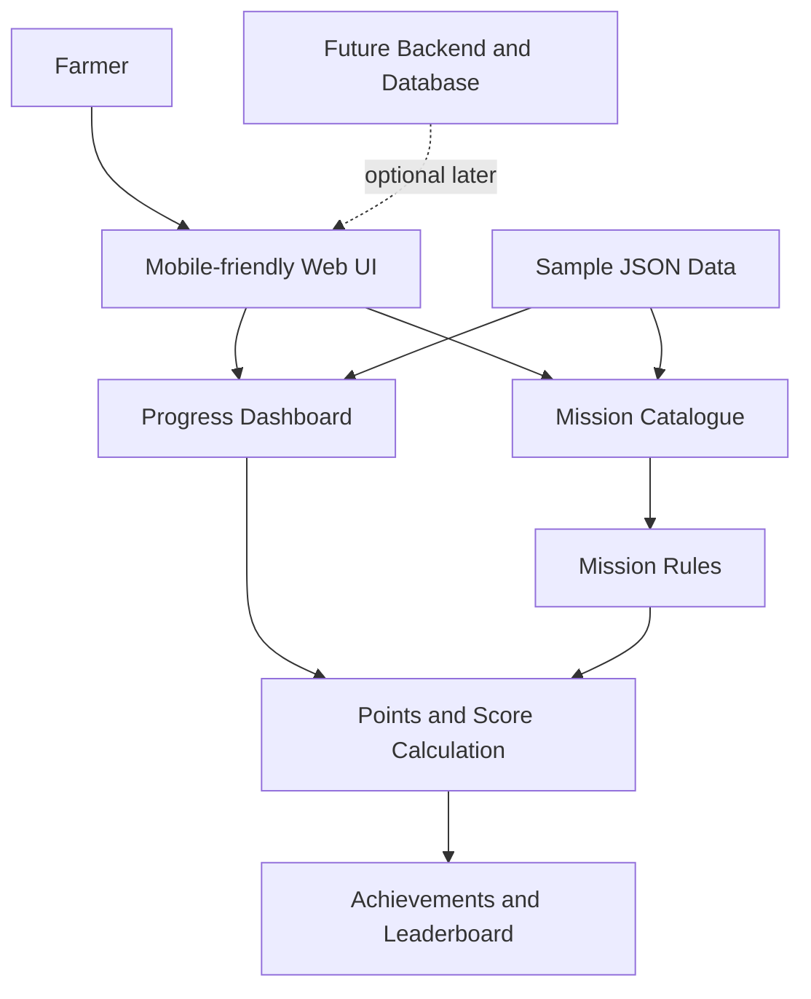
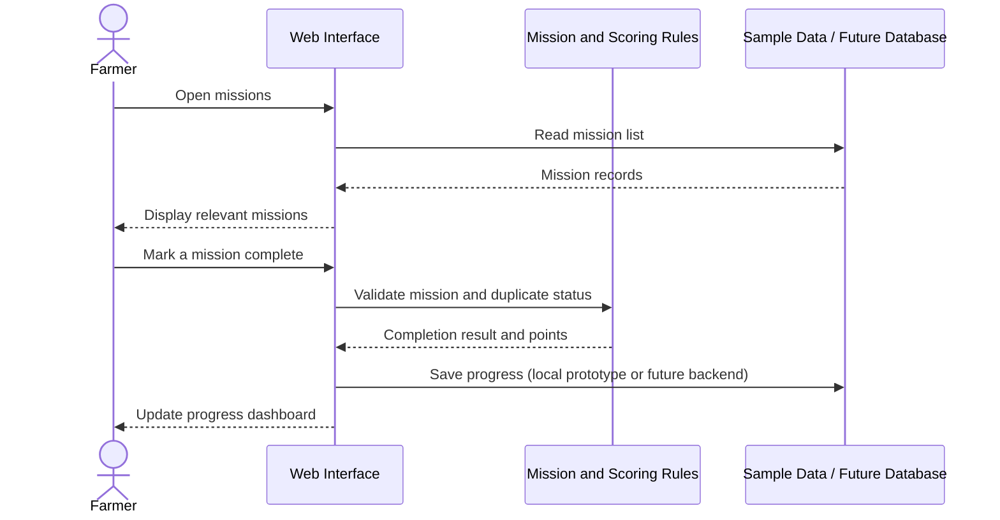

# FarmPlay — Technical Design Document

**Status:** Proposed design for an idea-stage project  
**Version:** 0.1  
**Last updated:** 2026-10-27

## 1. Purpose
This document describes the proposed architecture and main components of FarmPlay, a gamified platform intended to encourage sustainable farming practices. It is a design proposal, not a description of an already deployed system.

## 2. Goals
- Present farmers with simple, relevant sustainability missions.
- Track mission completion and progress.
- Award points and badges using transparent rules.
- Show an indicative sustainability score.
- Support optional community learning and leaderboards.

## 3. Users
- **Farmer:** Views missions, records progress, and reviews achievements.
- **Project administrator (future):** Reviews mission content and manages reported or inappropriate content.

## 4. Proposed technology
| Layer | Proposed option | Purpose |
|---|---|---|
| User interface | HTML, CSS, JavaScript | Mobile-friendly web pages |
| Initial data | Local JSON files | Prototype farmer and mission records |
| Backend (later) | Supabase, if needed | Authentication and application APIs |
| Database (later) | Supabase PostgreSQL | Persistent farmer, mission, and progress records |
| Repository | GitHub | Version control and project documentation |

The team may revise this stack after testing the simplest prototype.

## 5. High-level architecture

**Diagram note:** The first prototype can read local sample JSON data. The backend/database connection is a future option and is not implemented yet.

## 6. Main modules
### 6.1 Farmer profile
Stores a farmer identifier, display name, region, crop type, and approximate farm size. Use fictional data during development. Collect only information needed for the prototype.

### 6.2 Mission catalogue
Displays a list of missions, including title, category, description, difficulty, suggested duration, and points. Mission content should be reviewed for local relevance before being presented as advice.

### 6.3 Mission completion
Allows a farmer to mark a mission as completed and, in a later version, optionally submit evidence for review. The prototype should prevent duplicate completion from awarding points repeatedly.

### 6.4 Points and achievements
Awards points based on a published rule for each mission. Badges can recognise milestones such as completing a first mission or maintaining a consistent learning streak. Points indicate platform participation; they do not by themselves prove environmental impact.

### 6.5 Sustainability score
A proposed score from 0 to 100 can be calculated from completed eligible missions. For the first prototype, use a transparent illustrative formula:

`score = min(100, total_eligible_points / target_points * 100)`

For example, if the target is 100 eligible points and the farmer has 40, the illustrative score is 40/100. The target and weights must be validated with domain experts before the score is used beyond a demo.

### 6.6 Community and leaderboard
A later version may show opt-in display names and rankings. Do not expose private profile information. Provide a way to opt out of public rankings.

## 7. Proposed data flow

The sequence is intended to guide implementation. Persistence, authentication, and verification depend on the chosen implementation.

## 8. Initial data model
- **Farmer:** `farmer_id`, `display_name`, `region`, `crop_type`, `farm_size_acres`
- **Mission:** `mission_id`, `title`, `category`, `description`, `difficulty`, `points`, `duration_days`
- **Completion:** `completion_id`, `farmer_id`, `mission_id`, `completed_at`, `status`
- **Achievement (future):** `achievement_id`, `farmer_id`, `badge_code`, `awarded_at`

A future database should enforce valid references between farmers, missions, and completions, and prevent duplicate awards for the same completion.

## 9. Security and privacy considerations
- Use fictional sample records in the public repository.
- Do not commit real farmer contact details, passwords, access tokens, or secrets.
- If accounts are introduced, use a reputable authentication provider and enforce server-side access controls.
- If Supabase is used, enable Row Level Security and write policies before storing user data.
- Keep leaderboard participation optional and avoid publishing precise farm locations.
- Validate completion inputs and avoid trusting client-side point totals as authoritative.
- Ask for informed consent before collecting or sharing any personal data.

## 10. Limitations and risks
- A completed mission does not automatically prove a sustainable outcome.
- Self-reported activity may be inaccurate; verification options may be needed.
- Farming practices depend on local soil, weather, crop, water availability, and expert advice.
- Internet access and digital literacy may vary.
- Incentives and leaderboard design should avoid unfairly penalising farmers with fewer resources.

## 11. Implementation phases
1. **Phase 1 — Documentation:** Define users, missions, sample data, and test scenarios.
2. **Phase 2 — Clickable/working UI prototype:** Display sample profiles and missions.
3. **Phase 3 — Core logic:** Record completion, prevent duplicate awards, and calculate points.
4. **Phase 4 — User feedback:** Test with representative users and refine usability.
5. **Phase 5 — Optional backend:** Add authentication and persistent storage only if required.
6. **Phase 6 — Pilot evaluation:** Define measurable indicators and assess actual outcomes.

## 12. Acceptance criteria for the first prototype
- The mission list displays the sample missions.
- A user can inspect mission details.
- A completion action updates the demo progress state.
- Duplicate completion does not award points twice.
- The displayed score follows a documented formula.
- Empty or invalid data is handled with a clear message.
- The interface remains usable on a phone-sized screen.

These are planned acceptance criteria; they have not yet been tested against an implemented app.
